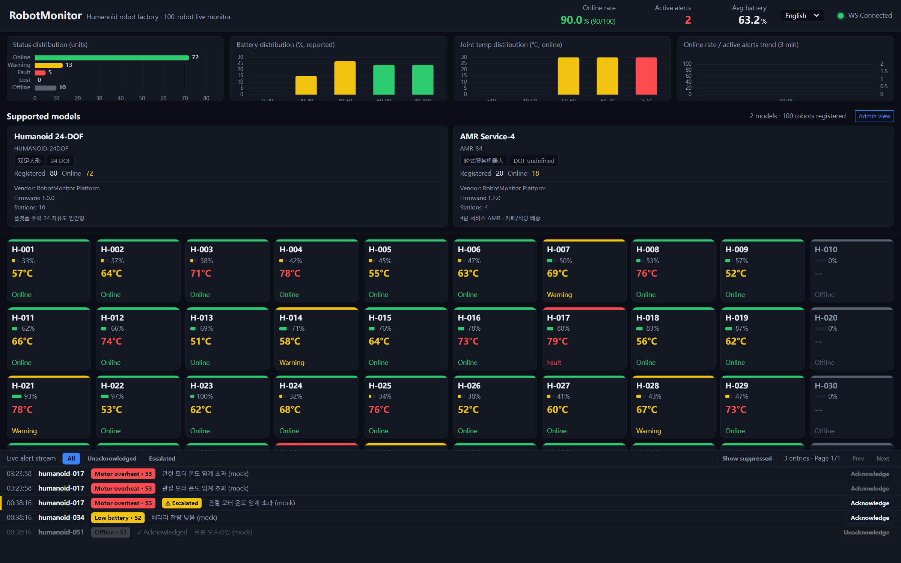
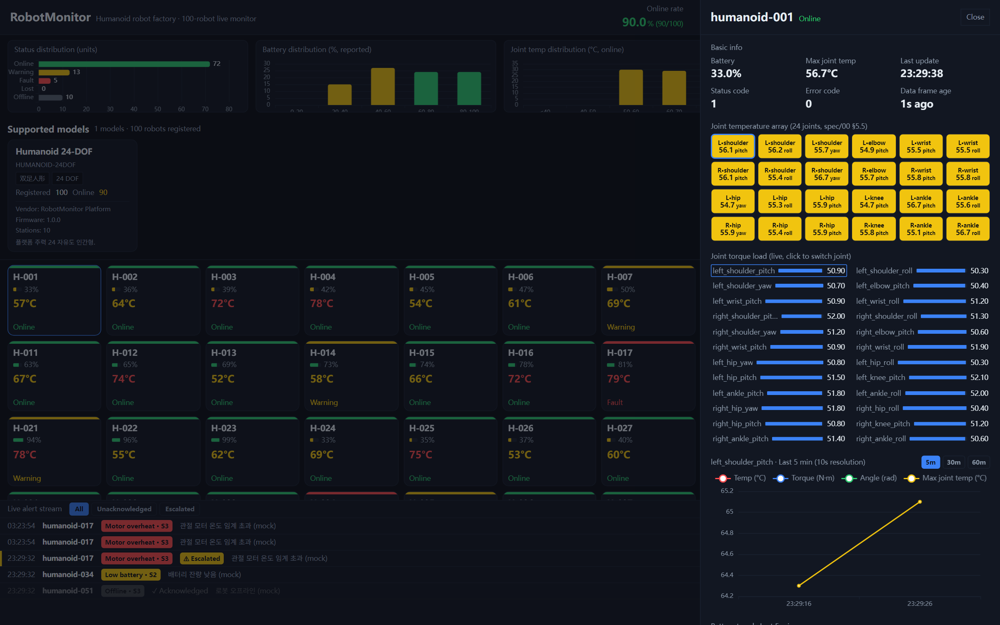
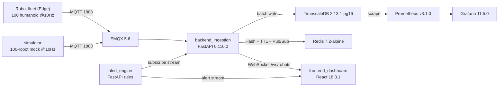

# RobotMonitor — 100대 휴머노이드 로봇 공장 실시간 모니터링

RobotMonitor는 공장 바닥의 **휴머노이드 로봇 100대**를 실시간으로 감시하는 오픈소스 운영 대시보드입니다. 온/오프라인 상태, 배터리, 모터·관절 온도, 토크, 고장 코드, 실시간 알림을 확인할 수 있습니다.

고빈도 원격 측정(로봇 100대 × 10Hz = 초당 1000건)은 MQTT로 전송되며, FastAPI 수집 서비스가 **TimescaleDB**에 배치 저장하고 최신 상태를 **Redis**(Hash + TTL + Pub/Sub)에 캐시한 뒤 **WebSocket**으로 React 대시보드에 스트리밍합니다. 알림 엔진은 스트림을 구독해 규칙을 평가하고 UI 알림 스트림으로 전달합니다.

> 🌍 **이 프로젝트는 국제적입니다.** 문서는 다음 언어로 제공됩니다:
> - 🇺🇸 [English](./README.md)
> - 🇰🇷 **한국어** (이 파일)
> - 🇨🇳 [中文](./README.zh.md)
>
> 대시보드 UI 자체도 **English / 한국어 / 中文 / 日本語**를 실시간 언어 전환기와 함께 지원합니다(기본값: English). [docs/README.md](./docs/README.md) 참고.

<p align="center">
  <a href="https://github.com/TopRemnantAcademy/robot-monitor/actions/workflows/ci.yml"></a>
  
  
  
  
</p>

---

## 미리보기

<p align="center">
  
  <br/>
  <em>실시간 fleet 뷰 — 100대 휴머노이드 로봇의 상태/배터리/온도와 실시간 알림 스트림.</em>
</p>

<p align="center">
  
  <br/>
  <em>로봇별 상세 드로어 — 관절 온도 차트, 최근 이력, 알림 타임라인.</em>
</p>

> Docker 없이 직접 보고 싶으신가요? 아래 '빠른 시작 (프론트엔드만)' 섹션의 **목 백엔드**를 실행하세요.

---

## 아키텍처

```
로봇 군단(Edge) --MQTT--> [backend_ingestion] --배치--> TimescaleDB
                            |-- Redis (Hash + TTL) + Pub/Sub
[alert_engine]   --스트림 구독--> 규칙 평가 --> robot_alert + UI 알림 스트림
[frontend_dashboard] <--WebSocket /ws/robots-- [backend_ingestion]
[simulator]      --MQTT--> 로봇 100대 @10Hz + 고장 주입 (부하 테스트)
```

| 경로 | 설명 |
| :--- | :--- |
| `docs/` | 아키텍처 문서, 개발자 가이드, API 계약(`openapi`, `ws-envelope`), 감사 노트 |
| `infra/` | `docker-compose.yml`(EMQX + TimescaleDB + Redis), `init.sql`(하이퍼테이블 + 연속 집계) |
| `backend_ingestion/` | FastAPI 수집·저장 서비스(`/ws/robots` 및 REST 제공) |
| `alert_engine/` | 알림·건강 규칙 엔진 |
| `frontend_dashboard/` | React 대시보드(Vite + ECharts + TanStack Query + zustand) |
| `simulator/` | 100대 로봇 원격 측정 시뮬레이터(고장 주입 포함) |
| `test_integration.sh` | 엔드투엔드 스모크 스크립트 |

---

## 빠른 시작 (전체 스택, Docker)

```bash
docker compose -f infra/docker-compose.yml up -d   # 미들웨어 기동(EMQX, TimescaleDB, Redis)
bash test_integration.sh                            # 엔드투엔드 스모크 테스트(먼저 모듈 빌드)
```

그 후 대시보드 개발 서버를 엽니다:

```bash
cd frontend_dashboard
npm install
npm run dev        # Vite 개발 서버 http://localhost:5173
```

---

## 빠른 시작 (프론트엔드만 — Docker 불필요)

Docker를 실행할 수 없는 환경에서는 **목 백엔드**를 통해 인프라 없이 WebSocket + REST 계약을 에뮬레이션하며 대시보드를 실행할 수 있습니다:

```bash
cd frontend_dashboard
npm install
node mock_backend.mjs            # 목 WS + REST 서버 :8787
VITE_API_BASE=http://localhost:8787 VITE_WS_HOST=localhost VITE_WS_PORT=8787 npm run dev   # Vite :5173, 목 백엔드 연결
```

목 백엔드는 **프론트엔드 기여자**와 Docker 없는 머신에서의 CI 로컬 테스트에 권장되는 경로입니다. 자세한 내용은 [docs/developer-guide.md](./docs/developer-guide.md) 참고.

---

## 국제화(i18n)

대시보드는 English(기본값), 한국어, 중국어를 제공합니다. UI 문자열은 [`frontend_dashboard/src/i18n/locales.ts`](./frontend_dashboard/src/i18n/locales.ts)에 있으며 `useI18n()` 훅으로 해석되고, 상단 헤더에 언어 전환기가 있습니다. **서버가 제공하는 데이터**(알림 메시지, 로봇 이름)는 의도적으로 번역하지 않습니다.

언어를 추가하려면: `locales.ts`에 `Locale` 항목을 추가하고 `LanguageSwitcher.tsx`의 `<select>` 옵션을 추가하세요.

---


---

## 기술 스택

> Auto-generated from `infra/docker-compose.yml`, `*/requirements.txt`, and `frontend_dashboard/package.json` by `scripts/gen_techstack.py`. Run it after changing dependencies so this diagram stays in sync.

<!-- TECHSTACK-START -->

### System topology



### Tech stack by layer

```mermaid
graph TD
  subgraph EDGE["Edge / Simulation (Python 3.11)"]
    direction TB
    edge_aiomqtt["aiomqtt 2.5.1"]
    edge_rich["rich 15.0.0"]
  end
  subgraph INFRA_MESSAGING["Messaging"]
    direction TB
    infra_emqx["EMQX 5.6<br/><i>MQTT broker</i>"]
  end
  subgraph INFRA_STORAGE["Storage"]
    direction TB
    infra_timescaledb["TimescaleDB 2.13.1-pg16<br/><i>time-series PostgreSQL</i>"]
  end
  subgraph INFRA_CACHE["Storage and Cache"]
    direction TB
    infra_redis["Redis 7.2-alpine<br/><i>latest-state cache</i>"]
  end
  subgraph INFRA_OBSERVABILITY["Observability"]
    direction TB
    infra_prometheus["Prometheus v3.1.0<br/><i>metrics TSDB</i>"]
    infra_emqx_exporter["EMQX exporter 0.2.3<br/><i>EMQX metrics</i>"]
    infra_blackbox_exporter["Blackbox exporter v0.26.0<br/><i>probe exporter</i>"]
    infra_postgres_exporter["Postgres exporter v0.17.0<br/><i>Postgres metrics</i>"]
    infra_redis_exporter["Redis exporter v1.67.0<br/><i>Redis metrics</i>"]
    infra_grafana["Grafana 11.5.0<br/><i>dashboards</i>"]
  end
  subgraph BACKEND["Backend services (FastAPI)"]
    direction TB
    be_fastapi["fastapi 0.110.0"]
    be_uvicorn_standard_["uvicorn[standard] 0.28.0"]
    be_pydantic["pydantic 2.14.3"]
    be_pydantic_settings["pydantic-settings 2.16.2"]
    be_asyncpg["asyncpg 0.32.0"]
    be_sqlalchemy_asyncio_["sqlalchemy[asyncio] 2.0.28"]
    be_redis_hiredis_["redis[hiredis] 8.1.0"]
    be_aiomqtt["aiomqtt 2.5.1"]
    be_websockets["websockets 17.4"]
    be_prometheus_client["prometheus-client 0.26.0"]
    be_fastapi_users_sqlalchemy_["fastapi-users[sqlalchemy] 12.1.3"]
    be_setuptools["setuptools (&lt;81)"]
    be_bcrypt["bcrypt 4.0.1"]
    be_opentelemetry["OpenTelemetry 1.22.0 + instrumentation 0.43b0"]
  end
  subgraph FE["Frontend (React + Vite)"]
    direction TB
    fe__tanstack_react_query["@tanstack/react-query 5.106.1"]
    fe_echarts["echarts 5.5.1"]
    fe_echarts_for_react["echarts-for-react 3.0.6"]
    fe_react["react 18.3.1"]
    fe_react_dom["react-dom 18.3.1"]
    fe_react_error_boundary["react-error-boundary 6.1.6"]
    fe_zustand["zustand 4.5.5"]
  end
  subgraph FEDEV["Frontend tooling"]
    direction TB
    fedev__testing_library_dom["@testing-library/dom 10.4.0"]
    fedev__testing_library_jest_dom["@testing-library/jest-dom 7.0.1"]
    fedev__testing_library_react["@testing-library/react 16.1.0"]
    fedev__testing_library_user_event["@testing-library/user-event 14.5.2"]
    fedev__types_react["@types/react 18.3.12"]
    fedev__types_react_dom["@types/react-dom 18.3.1"]
    fedev__vitejs_plugin_react["@vitejs/plugin-react 4.3.4"]
    fedev_ajv["ajv 8.20.0"]
    fedev_autoprefixer["autoprefixer 10.4.20"]
    fedev_esbuild["esbuild 0.21.5"]
    fedev_happy_dom["happy-dom 21.0.4"]
    fedev_jsdom["jsdom 25.0.1"]
    fedev_openapi_typescript["openapi-typescript 7.13.0"]
    fedev_msw["msw 2.7.0"]
    fedev_postcss["postcss 8.4.49"]
    fedev_puppeteer["puppeteer 23.11.1"]
    fedev_tailwindcss["tailwindcss 3.4.17"]
    fedev_typescript["typescript 5.6.3"]
    fedev_vite["vite 5.4.11"]
    fedev_vitest["vitest 2.1.8"]
    fedev_ws["ws 8.18.0"]
  end
```



<!-- TECHSTACK-END -->
## 기여하기

초심자 PR부터 로보틱스 도메인 전문가까지 모든 수준의 기여를 환영합니다. 다음을 읽어 주세요:

- 📖 [CONTRIBUTING.md](./CONTRIBUTING.md) — 설정, 브랜치, PR 방법
- 📐 [docs/developer-guide.md](./docs/developer-guide.md) — 아키텍처, 개발 워크플로, 목 백엔드 경로
- 🤝 [CODE_OF_CONDUCT.md](./CODE_OF_CONDUCT.md) — 커뮤니티 표준
- 🔒 [SECURITY.md](./SECURITY.md) — 취약점 보고 방법

- 🗺️ [ROADMAP.md](./ROADMAP.md) — 현재 위치와 기여 지점
- 💡 기능 제안은 **Feature request** 이슈나 **Discussions · Ideas**에서

입문용 이슈는 [`good first issue`](https://github.com/TopRemnantAcademy/robot-monitor/labels/good%20first%20issue) 태그로 표시됩니다. 더 큰 작업은 [`help wanted`](https://github.com/TopRemnantAcademy/robot-monitor/labels/help%20wanted) 태그를 사용합니다.

---

## 라이선스

[MIT](./LICENSE) — 상용 및 개인 사용 모두 자유롭게 사용 가능.
