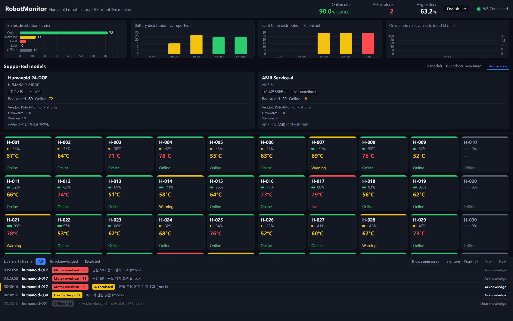
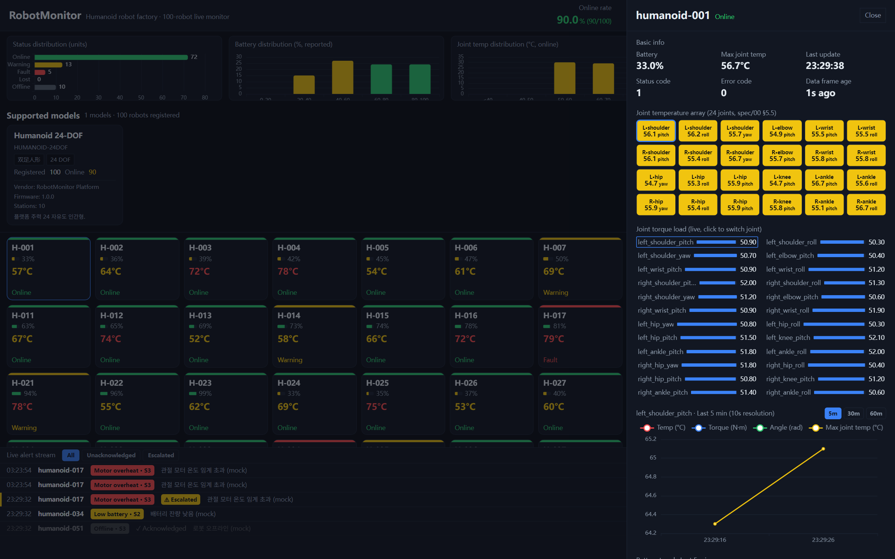
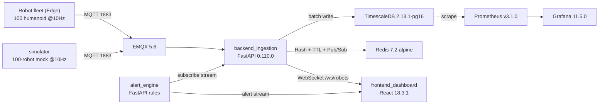

# RobotMonitor — Live monitoring for a 100-robot humanoid factory

RobotMonitor is an open-source operations dashboard that watches **100 humanoid robots** on a factory floor in real time: online/offline status, battery, motor & joint temperatures, torque, fault codes, and live alerts.

High-frequency telemetry (100 robots × 10 Hz = 1000 msg/s) flows over MQTT → a FastAPI ingestion service that batch-writes to **TimescaleDB**, caches the latest state in **Redis** (Hash + TTL + Pub/Sub), and streams it to the React dashboard over **WebSocket**. An alert engine subscribes to the stream, evaluates rules, and pushes alerts to the UI.

> 🌍 **This project is international.** Documentation is available in:
> - 🇺🇸 **English** (this file)
> - 🇰🇷 [Korean](./README.ko.md)
> - 🇨🇳 [Chinese](./README.zh.md)
>
> The dashboard UI itself supports **English / Korean / Chinese / Japanese** with a live language switcher (default: English). See [docs/README.md](./docs/README.md).

<p align="center">
  <a href="https://github.com/TopRemnantAcademy/robot-monitor/actions/workflows/ci.yml"></a>
  
  
  
  
</p>

---

## Preview

<p align="center">
  
  <br/>
  <em>Live fleet view — 100 humanoid robots with status / battery / temperature and a real-time alert stream.</em>
</p>

<p align="center">
  
  <br/>
  <em>Per-robot detail drawer — joint-temperature chart, recent history, and alert timeline.</em>
</p>

> Want to see it live without Docker? Run the **mock backend** — see [Quick start (frontend only)](#quick-start-frontend-only--no-docker-needed).

---

## Architecture

```
Robot fleet (Edge) --MQTT--> [backend_ingestion] --batch--> TimescaleDB
                            |-- Redis (Hash + TTL) + Pub/Sub
[alert_engine]   --subscribe stream--> rule evaluation --> robot_alert + UI alert stream
[frontend_dashboard] <--WebSocket /ws/robots-- [backend_ingestion]
[simulator]      --MQTT--> emulates 100 robots @10Hz + fault injection (load testing)
```

| Path | What it is |
| :--- | :--- |
| `docs/` | Architecture write-up, developer guide, API contracts (`openapi`, `ws-envelope`), and audit notes |
| `infra/` | `docker-compose.yml` (EMQX + TimescaleDB + Redis), `init.sql` (hypertables + continuous aggregates) |
| `backend_ingestion/` | FastAPI ingestion + storage service (serves `/ws/robots` and REST) |
| `alert_engine/` | Alert / health rule engine |
| `frontend_dashboard/` | React dashboard (Vite + ECharts + TanStack Query + zustand) |
| `simulator/` | 100-robot telemetry simulator with fault injection |
| `test_integration.sh` | End-to-end smoke script |

---

## Quick start (full stack, Docker)

```bash
docker compose -f infra/docker-compose.yml up -d   # start middleware (EMQX, TimescaleDB, Redis)
bash test_integration.sh                            # end-to-end smoke test (build modules first)
```

Then open the dashboard dev server:

```bash
cd frontend_dashboard
npm install
npm run dev        # Vite dev server on http://localhost:5173
```

---

## Quick start (frontend only — no Docker needed)

If you cannot run Docker in your environment, the dashboard can run against a **mock backend** that emulates the WebSocket + REST contract without any infrastructure:

```bash
cd frontend_dashboard
npm install
node mock_backend.mjs            # mock WS + REST server on :8787
VITE_API_BASE=http://localhost:8787 VITE_WS_HOST=localhost VITE_WS_PORT=8787 npm run dev   # Vite on :5173, talking to the mock
```

The mock backend is the recommended path for **frontend contributors** and CI-local testing on machines without Docker. See [docs/developer-guide.md](./docs/developer-guide.md) for details.

---

## Internationalization (i18n)

The dashboard ships with English (default), Korean, Chinese, and Japanese. UI chrome strings live in [`frontend_dashboard/src/i18n/locales.ts`](./frontend_dashboard/src/i18n/locales.ts) and are resolved through the `useI18n()` hook; a language switcher lives in the top header. **Server-supplied data** (alert messages, robot names) is intentionally *not* translated.

To add a language: add a `Locale` entry and its string dictionary in `locales.ts`; the switcher in the top header picks it up automatically from the `LOCALES` array.

---


---

## Tech stack

> Auto-generated from `infra/docker-compose.yml`, `*/requirements.txt`, and `frontend_dashboard/package.json` by `scripts/gen_techstack.py`. Run it after changing dependencies so this diagram stays in sync.

<!-- TECHSTACK-START -->

### System topology



### Tech stack by layer

```mermaid
graph TD
  subgraph EDGE["Edge / Simulation (Python 3.11)"]
    direction TB
    edge_aiomqtt["aiomqtt 2.5.1"]
    edge_rich["rich 15.0.0"]
  end
  subgraph INFRA_MESSAGING["Messaging"]
    direction TB
    infra_emqx["EMQX 5.6<br/><i>MQTT broker</i>"]
  end
  subgraph INFRA_STORAGE["Storage"]
    direction TB
    infra_timescaledb["TimescaleDB 2.13.1-pg16<br/><i>time-series PostgreSQL</i>"]
  end
  subgraph INFRA_CACHE["Storage and Cache"]
    direction TB
    infra_redis["Redis 7.2-alpine<br/><i>latest-state cache</i>"]
  end
  subgraph INFRA_OBSERVABILITY["Observability"]
    direction TB
    infra_prometheus["Prometheus v3.1.0<br/><i>metrics TSDB</i>"]
    infra_emqx_exporter["EMQX exporter 0.2.3<br/><i>EMQX metrics</i>"]
    infra_blackbox_exporter["Blackbox exporter v0.26.0<br/><i>probe exporter</i>"]
    infra_postgres_exporter["Postgres exporter v0.17.0<br/><i>Postgres metrics</i>"]
    infra_redis_exporter["Redis exporter v1.67.0<br/><i>Redis metrics</i>"]
    infra_grafana["Grafana 11.5.0<br/><i>dashboards</i>"]
  end
  subgraph BACKEND["Backend services (FastAPI)"]
    direction TB
    be_fastapi["fastapi 0.110.0"]
    be_uvicorn_standard_["uvicorn[standard] 0.28.0"]
    be_pydantic["pydantic 2.14.3"]
    be_pydantic_settings["pydantic-settings 2.16.2"]
    be_asyncpg["asyncpg 0.32.0"]
    be_sqlalchemy_asyncio_["sqlalchemy[asyncio] 2.0.28"]
    be_redis_hiredis_["redis[hiredis] 8.1.0"]
    be_aiomqtt["aiomqtt 2.5.1"]
    be_websockets["websockets 17.4"]
    be_prometheus_client["prometheus-client 0.26.0"]
    be_fastapi_users_sqlalchemy_["fastapi-users[sqlalchemy] 12.1.3"]
    be_setuptools["setuptools (&lt;81)"]
    be_bcrypt["bcrypt 4.0.1"]
    be_opentelemetry["OpenTelemetry 1.22.0 + instrumentation 0.43b0"]
  end
  subgraph FE["Frontend (React + Vite)"]
    direction TB
    fe__tanstack_react_query["@tanstack/react-query 5.106.1"]
    fe_echarts["echarts 5.5.1"]
    fe_echarts_for_react["echarts-for-react 3.0.6"]
    fe_react["react 18.3.1"]
    fe_react_dom["react-dom 18.3.1"]
    fe_react_error_boundary["react-error-boundary 6.1.6"]
    fe_zustand["zustand 4.5.5"]
  end
  subgraph FEDEV["Frontend tooling"]
    direction TB
    fedev__testing_library_dom["@testing-library/dom 10.4.0"]
    fedev__testing_library_jest_dom["@testing-library/jest-dom 7.0.1"]
    fedev__testing_library_react["@testing-library/react 16.1.0"]
    fedev__testing_library_user_event["@testing-library/user-event 14.5.2"]
    fedev__types_react["@types/react 18.3.12"]
    fedev__types_react_dom["@types/react-dom 18.3.1"]
    fedev__vitejs_plugin_react["@vitejs/plugin-react 4.3.4"]
    fedev_ajv["ajv 8.20.0"]
    fedev_autoprefixer["autoprefixer 10.4.20"]
    fedev_esbuild["esbuild 0.21.5"]
    fedev_happy_dom["happy-dom 21.0.4"]
    fedev_jsdom["jsdom 25.0.1"]
    fedev_openapi_typescript["openapi-typescript 7.13.0"]
    fedev_msw["msw 2.7.0"]
    fedev_postcss["postcss 8.4.49"]
    fedev_puppeteer["puppeteer 23.11.1"]
    fedev_tailwindcss["tailwindcss 3.4.17"]
    fedev_typescript["typescript 5.6.3"]
    fedev_vite["vite 5.4.11"]
    fedev_vitest["vitest 2.1.8"]
    fedev_ws["ws 8.18.0"]
  end
```



<!-- TECHSTACK-END -->
## Contributing

We welcome contributors of every level — from first-time PRs to robotics-domain experts. Please read:

- 📖 [CONTRIBUTING.md](./CONTRIBUTING.md) — how to set up, branch, and open a PR
- 📐 [docs/developer-guide.md](./docs/developer-guide.md) — architecture, dev workflow, and the mock-backend path
- 🤝 [CODE_OF_CONDUCT.md](./CODE_OF_CONDUCT.md) — community standards
- 🔒 [SECURITY.md](./SECURITY.md) — how to report vulnerabilities
- 🗺️ [ROADMAP.md](./ROADMAP.md) — where we are and where to plug in
- 💡 Propose a feature via a **Feature request** issue or **Discussions · Ideas**

Good first issues are tagged [`good first issue`](https://github.com/TopRemnantAcademy/robot-monitor/labels/good%20first%20issue); bigger tasks are tagged [`help wanted`](https://github.com/TopRemnantAcademy/robot-monitor/labels/help%20wanted).

---

## License

[AGPL-3.0](./LICENSE) — free software; network use requires offering source.
