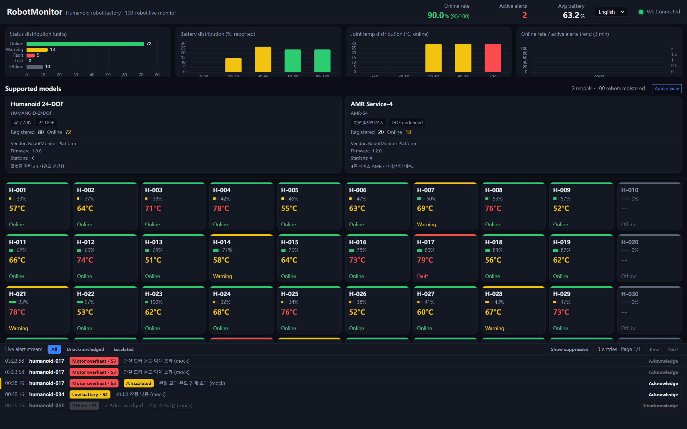
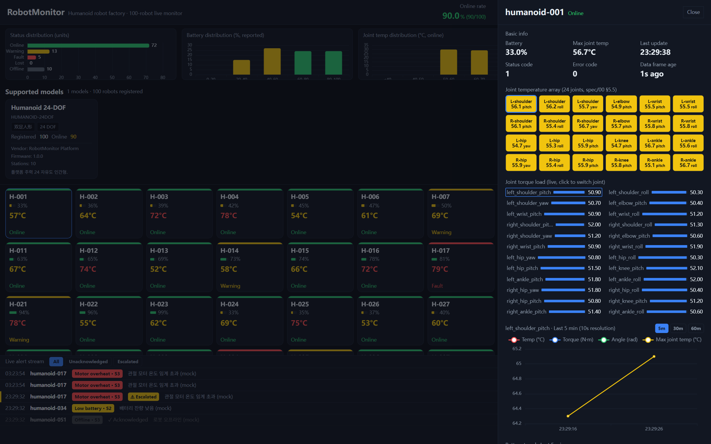
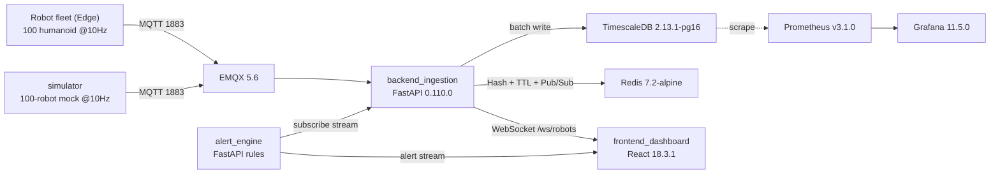

# RobotMonitor — 100 台人形机器人工厂实时监控系统

RobotMonitor 是一个开源运维看板，实时监视工厂车间的 **100 台人形机器人**：在线/离线状态、电量、电机与关节温度、扭矩、故障码，以及实时告警。

高频遥测（100 台 × 10Hz = 1000 条/秒）经 MQTT 传输，由 FastAPI 采集服务**批量写入 TimescaleDB**，将最新状态缓存在 **Redis**（Hash + TTL + Pub/Sub）中，并通过 **WebSocket** 推送到 React 看板。告警引擎订阅数据流，执行规则评估，并将告警送入 UI 告警流。

> 🌍 **本项目国际化。** 文档提供以下语言版本：
> - 🇺🇸 [English](./README.md)
> - 🇰🇷 [한국어](./README.ko.md)
> - 🇨🇳 **中文**（本文件）
>
> 看板界面本身支持 **English / 한국어 / 中文 / 日本語**，并带有实时语言切换器（默认：English）。详见 [docs/README.md](./docs/README.md)。

<p align="center">
  <a href="https://github.com/TopRemnantAcademy/robot-monitor/actions/workflows/ci.yml"></a>
  
  
  
  
</p>

---

## 预览

<p align="center">
  
  <br/>
  <em>实时 fleet 视图 — 100 台人形机器人的状态 / 电量 / 温度以及实时告警流。</em>
</p>

<p align="center">
  
  <br/>
  <em>单台机器人详情抽屉 — 关节温度图、近期历史与告警时间线。</em>
</p>

> 不想用 Docker 也想看效果？运行下方“快速开始（仅前端）”里的 **mock 后端** 即可。

---

## 架构

```
机器人集群(Edge) --MQTT--> [backend_ingestion] --批量--> TimescaleDB
                            |-- Redis (Hash + TTL) + Pub/Sub
[alert_engine]   --订阅数据流--> 规则评估 --> robot_alert + UI 告警流
[frontend_dashboard] <--WebSocket /ws/robots-- [backend_ingestion]
[simulator]      --MQTT--> 模拟 100 台 @10Hz + 异常注入（压测用）
```

| 路径 | 说明 |
| :--- | :--- |
| `docs/` | 架构文档、开发者指南、API 契约（`openapi`、`ws-envelope`）与审计笔记 |
| `infra/` | `docker-compose.yml`（EMQX + TimescaleDB + Redis）、`init.sql`（超表 + 连续聚合） |
| `backend_ingestion/` | FastAPI 采集存储服务（提供 `/ws/robots` 与 REST） |
| `alert_engine/` | 告警/健康规则引擎 |
| `frontend_dashboard/` | React 看板（Vite + ECharts + TanStack Query + zustand） |
| `simulator/` | 100 台遥测模拟器（含异常注入） |
| `test_integration.sh` | 端到端联调脚本 |

---

## 快速开始（全栈，Docker）

```bash
docker compose -f infra/docker-compose.yml up -d   # 启动中间件（EMQX、TimescaleDB、Redis）
bash test_integration.sh                            # 端到端联调（需先构建各模块）
```

随后打开看板开发服务器：

```bash
cd frontend_dashboard
npm install
npm run dev        # Vite 开发服务器 http://localhost:5173
```

---

## 快速开始（仅前端 — 无需 Docker）

若环境中无法运行 Docker，看板可借助**模拟后端**在无需任何基础设施的情况下运行，该后端会模拟 WebSocket + REST 契约：

```bash
cd frontend_dashboard
npm install
node mock_backend.mjs            # 模拟 WS + REST 服务器 :8787
VITE_API_BASE=http://localhost:8787 VITE_WS_HOST=localhost VITE_WS_PORT=8787 npm run dev   # Vite :5173，对接模拟后端
```

模拟后端是**前端贡献者**以及无 Docker 机器上的 CI 本地测试推荐路径。详见 [docs/developer-guide.md](./docs/developer-guide.md)。

---

## 国际化（i18n）

看板提供 English（默认）、한국어、中文三种语言。UI 文案集中在 [`frontend_dashboard/src/i18n/locales.ts`](./frontend_dashboard/src/i18n/locales.ts)，通过 `useI18n()` 钩子解析，顶部页眉内置语言切换器。**服务端下发的数据**（告警消息、机器人名称）刻意不做翻译。

新增语言：在 `locales.ts` 添加 `Locale` 项，并在 `LanguageSwitcher.tsx` 的 `<select>` 中添加选项即可。

---


---

## 技术栈

> Auto-generated from `infra/docker-compose.yml`, `*/requirements.txt`, and `frontend_dashboard/package.json` by `scripts/gen_techstack.py`. Run it after changing dependencies so this diagram stays in sync.

<!-- TECHSTACK-START -->

### System topology



### Tech stack by layer

```mermaid
graph TD
  subgraph EDGE["Edge / Simulation (Python 3.11)"]
    direction TB
    edge_aiomqtt["aiomqtt 2.5.1"]
    edge_rich["rich 15.0.0"]
  end
  subgraph INFRA_MESSAGING["Messaging"]
    direction TB
    infra_emqx["EMQX 5.6<br/><i>MQTT broker</i>"]
  end
  subgraph INFRA_STORAGE["Storage"]
    direction TB
    infra_timescaledb["TimescaleDB 2.13.1-pg16<br/><i>time-series PostgreSQL</i>"]
  end
  subgraph INFRA_CACHE["Storage and Cache"]
    direction TB
    infra_redis["Redis 7.2-alpine<br/><i>latest-state cache</i>"]
  end
  subgraph INFRA_OBSERVABILITY["Observability"]
    direction TB
    infra_prometheus["Prometheus v3.1.0<br/><i>metrics TSDB</i>"]
    infra_emqx_exporter["EMQX exporter 0.2.3<br/><i>EMQX metrics</i>"]
    infra_blackbox_exporter["Blackbox exporter v0.26.0<br/><i>probe exporter</i>"]
    infra_postgres_exporter["Postgres exporter v0.17.0<br/><i>Postgres metrics</i>"]
    infra_redis_exporter["Redis exporter v1.67.0<br/><i>Redis metrics</i>"]
    infra_grafana["Grafana 11.5.0<br/><i>dashboards</i>"]
  end
  subgraph BACKEND["Backend services (FastAPI)"]
    direction TB
    be_fastapi["fastapi 0.110.0"]
    be_uvicorn_standard_["uvicorn[standard] 0.28.0"]
    be_pydantic["pydantic 2.14.3"]
    be_pydantic_settings["pydantic-settings 2.16.2"]
    be_asyncpg["asyncpg 0.32.0"]
    be_sqlalchemy_asyncio_["sqlalchemy[asyncio] 2.0.28"]
    be_redis_hiredis_["redis[hiredis] 8.1.0"]
    be_aiomqtt["aiomqtt 2.5.1"]
    be_websockets["websockets 17.4"]
    be_prometheus_client["prometheus-client 0.26.0"]
    be_fastapi_users_sqlalchemy_["fastapi-users[sqlalchemy] 12.1.3"]
    be_setuptools["setuptools (&lt;81)"]
    be_bcrypt["bcrypt 4.0.1"]
    be_opentelemetry["OpenTelemetry 1.22.0 + instrumentation 0.43b0"]
  end
  subgraph FE["Frontend (React + Vite)"]
    direction TB
    fe__tanstack_react_query["@tanstack/react-query 5.106.1"]
    fe_echarts["echarts 5.5.1"]
    fe_echarts_for_react["echarts-for-react 3.0.6"]
    fe_react["react 18.3.1"]
    fe_react_dom["react-dom 18.3.1"]
    fe_react_error_boundary["react-error-boundary 6.1.6"]
    fe_zustand["zustand 4.5.5"]
  end
  subgraph FEDEV["Frontend tooling"]
    direction TB
    fedev__testing_library_dom["@testing-library/dom 10.4.0"]
    fedev__testing_library_jest_dom["@testing-library/jest-dom 7.0.1"]
    fedev__testing_library_react["@testing-library/react 16.1.0"]
    fedev__testing_library_user_event["@testing-library/user-event 14.5.2"]
    fedev__types_react["@types/react 18.3.12"]
    fedev__types_react_dom["@types/react-dom 18.3.1"]
    fedev__vitejs_plugin_react["@vitejs/plugin-react 4.3.4"]
    fedev_ajv["ajv 8.20.0"]
    fedev_autoprefixer["autoprefixer 10.4.20"]
    fedev_esbuild["esbuild 0.21.5"]
    fedev_happy_dom["happy-dom 21.0.4"]
    fedev_jsdom["jsdom 25.0.1"]
    fedev_openapi_typescript["openapi-typescript 7.13.0"]
    fedev_msw["msw 2.7.0"]
    fedev_postcss["postcss 8.4.49"]
    fedev_puppeteer["puppeteer 23.11.1"]
    fedev_tailwindcss["tailwindcss 3.4.17"]
    fedev_typescript["typescript 5.6.3"]
    fedev_vite["vite 5.4.11"]
    fedev_vitest["vitest 2.1.8"]
    fedev_ws["ws 8.18.0"]
  end
```



<!-- TECHSTACK-END -->
## 参与贡献

我们欢迎任何水平的贡献者——从首次提交到机器人领域专家。请阅读：

- 📖 [CONTRIBUTING.md](./CONTRIBUTING.md) — 环境搭建、分支与 PR 流程
- 📐 [docs/developer-guide.md](./docs/developer-guide.md) — 架构、开发流程与模拟后端路径
- 🤝 [CODE_OF_CONDUCT.md](./CODE_OF_CONDUCT.md) — 社区规范
- 🔒 [SECURITY.md](./SECURITY.md) — 漏洞报告方式

- 🗺️ [ROADMAP.md](./ROADMAP.md) — 项目现状与可参与方向
- 💡 功能提议请走 **Feature request** issue 或 **Discussions · Ideas**

入门友好问题标注 [`good first issue`](https://github.com/TopRemnantAcademy/robot-monitor/labels/good%20first%20issue)；更大的任务用 [`help wanted`](https://github.com/TopRemnantAcademy/robot-monitor/labels/help%20wanted) 标注。

---

## 许可证

[AGPL-3.0](./LICENSE) — 自由软件；网络使用需提供源代码。
