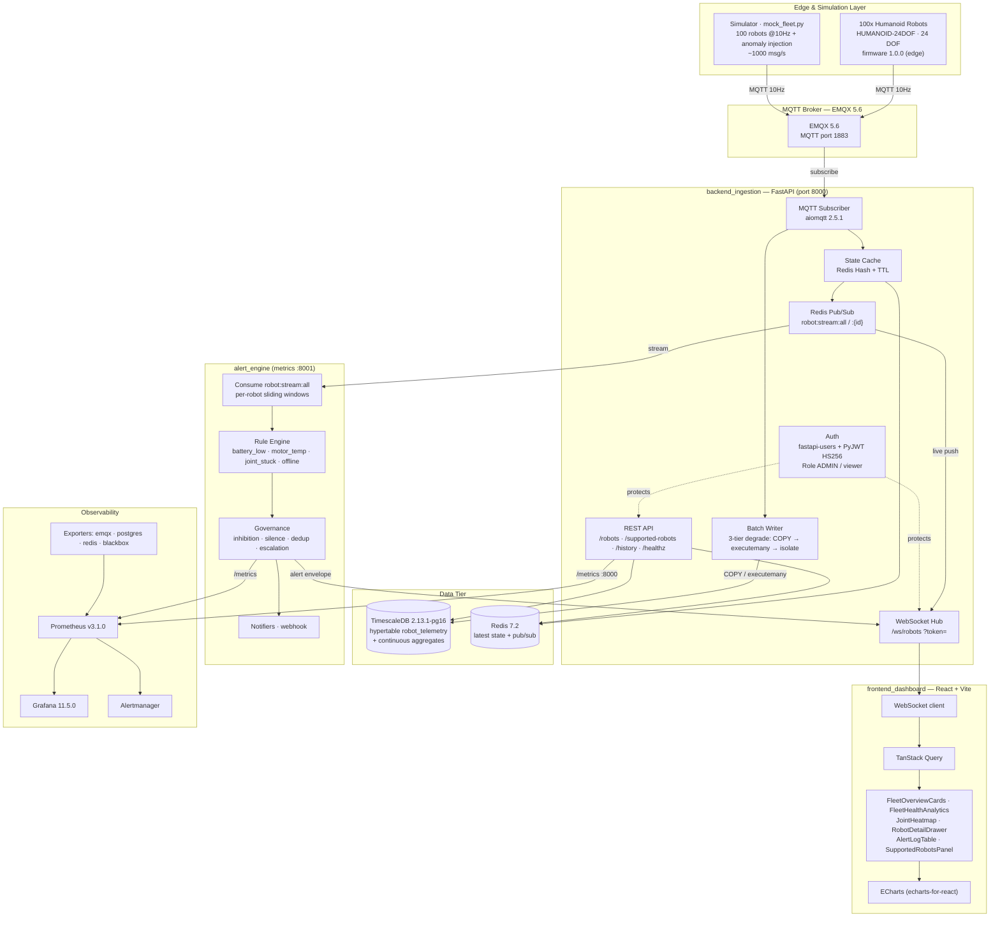

# RobotMonitor — System Architecture / 시스템 아키텍처

> **RobotMonitor** is a real-time 2D operations dashboard for a fleet of **100 humanoid robots** (`HUMANOID-24DOF`, 24 degrees of freedom, dual-legged).  
> **RobotMonitor**는 **휴머노이드 로봇 100대**(`HUMANOID-24DOF`, 24 자유도, 양족 보행) 실시간 2D 운영 대시보드입니다.
>
> Telemetry: 100 robots × 10 Hz = **1000 msg/s**.  
> 원격 측정: 로봇 100대 × 10Hz = **초당 1000 메시지**.
>
> This document is **machine-readable (Mermaid) + human-readable (text)** and can be imported into ProcessOn for editing.  
> 본 문서는 **기계 가독(Mermaid) + 인간 가독(텍스트)**이며, ProcessOn으로 가져와 편집할 수 있습니다.

---

## 1. Architecture Diagram (Mermaid) / 아키텍처 다이어그램



> **How to edit in ProcessOn**: copy the Mermaid block above → ProcessOn "Import / Mermaid" → editable diagram.  
> **ProcessOn에서 편집**: 위 Mermaid 블록 복사 → ProcessOn "Import / Mermaid" → 편집 가능 다이어그램.

---

## 2. Module Breakdown / 모듈 구성

| Module / 모듈 | Role (EN) | 역할 (KO) | Key files / 핵심 파일 |
|---|---|---|---|
| **simulator** | Emits synthetic fleet telemetry at 1000 msg/s with fault injection for load/stress testing. | 부하·스트레스 테스트용 합성 원격 측정 생성 (결함 주입 포함, 초당 1000 메시지). | `simulator/mock_fleet.py`, `task_sim.py` |
| **EMQX** | MQTT broker; ingress for all robot telemetry. | 모든 로봇 원격 측정의 수신(MQTT 브로커). | `infra/docker-compose.yml` |
| **backend_ingestion** | FastAPI service: subscribes MQTT, batch-writes TimescaleDB, caches latest state in Redis, publishes to Pub/Sub + WebSocket, serves REST + metrics. | FastAPI 서비스: MQTT 구독 → TimescaleDB 일괄 저장, Redis 최신 상태 캐시, Pub/Sub + WebSocket 발행, REST + 메트릭 제공. | `app/main.py`, `app/services/*`, `app/schemas/*`, `app/auth/*` |
| **alert_engine** | Consumes the Redis stream, evaluates health rules, governs alert lifecycle (inhibit/silence/dedup/escalate), notifies via webhook. | Redis 스트림 소비 → 상태 규칙 평가 → 경보 수명 주기 관리(억제/묵음/중복제거/에스컬레이션) → webhook 통지. | `alert_engine/app/main.py`, `app/rules/*`, `app/inhibition.py`, `app/notifiers/webhook.py` |
| **frontend_dashboard** | React + Vite single-page board: real-time fleet health, joint heatmap, robot detail, alert log, supported-robot catalog. | React + Vite SPA 대시보드: 실시간 기체 건강·관절 히트맵·로봇 상세·경보 로그·지원 기종 카탈로그. | `src/components/*`, `src/auth/*`, `src/App.tsx` |
| **TimescaleDB** | Time-series store (hypertable + continuous aggregates) for raw telemetry + alert history. | 원시 원격 측정 + 경보 이력 시계열 저장(초표 + 연속 집계). | `infra/init.sql`, `infra/docker-compose.yml` |
| **Redis** | Latest-state cache (Hash+TTL) and Pub/Sub transport between backend and alert/frontend. | 최신 상태 캐시(Hash+TTL) 및 백엔드↔경보/프론트 Pub/Sub 전송. | `app/db/redis.py`, `app/services/state_cache.py` |
| **Observability** | Prometheus scrapes backend/alert metrics + exporters; Grafana dashboards; Alertmanager routes. | Prometheus가 백엔드/경보 메트릭 + 익스포터 수집; Grafana 대시보드; Alertmanager 라우팅. | `infra/observability/*`, `infra/docker-compose.app.yml` |

---

## 3. Data Flow / 데이터 흐름

**EN**
1. Each robot (or the `simulator`) publishes telemetry over **MQTT @ 10 Hz** → **EMQX**.
2. **backend_ingestion** subscribes via `aiomqtt`, then:
   - writes batches to **TimescaleDB** through a 3-tier degrade chain (L1 `COPY` → L2 `executemany` → L3 isolate bad rows);
   - updates the **Redis** latest-state cache (Hash + TTL) and publishes each frame to `robot:stream:all` / `robot:stream:{id}` (Pub/Sub);
   - pushes **WebSocket** envelopes (`snapshot` / `telemetry` / `alert`) to the dashboard on `/ws/robots` (token via `?token=` query);
   - serves **REST** (`/robots`, `/supported-robots`, `/robots/{id}/history`, `/healthz`) and `/metrics` (`:8000`).
3. **alert_engine** consumes `robot:stream:all`, keeps a sliding window per robot, runs rules (`battery_low`, `motor_temp`, `joint_stuck`, `offline`), then applies governance (inhibition / silence / dedup / escalation) and emits alerts → back into the WebSocket alert envelope + `/metrics` (`:8001`) + webhook notifier.
4. **frontend_dashboard** connects via WebSocket + TanStack Query, renders with **ECharts**.
5. **Prometheus** scrapes both `/metrics` endpoints + exporters; **Grafana** visualizes; **Alertmanager** routes.

**KO**
1. 각 로봇(또는 `simulator`)이 **MQTT @ 10Hz**로 원격 측정 발행 → **EMQX**.
2. **backend_ingestion**이 `aiomqtt`로 구독 후:
   - 3단계 저하 체인(L1 `COPY` → L2 `executemany` → L3 불량 행 격리)으로 **TimescaleDB**에 일괄 저장;
   - **Redis** 최신 상태 캐시(Hash+TTL) 갱신 및 프레임을 `robot:stream:all` / `robot:stream:{id}`(Pub/Sub)로 발행;
   - WebSocket 봉투(`snapshot`/`telemetry`/`alert`)를 `/ws/robots`로 푸시(토큰은 `?token=` 쿼리);
   - **REST**(`/robots`, `/supported-robots`, `/robots/{id}/history`, `/healthz`) 및 `/metrics`(`:8000`) 제공.
3. **alert_engine**이 `robot:stream:all` 소비 → 로봇별 슬라이딩 윈도우 유지 → 규칙(`battery_low`, `motor_temp`, `joint_stuck`, `offline`) 실행 → 거버넌스(억제/묵음/중복제거/에스컬레이션) 적용 후 경보 발행 → WebSocket 경보 봉투 + `/metrics`(`:8001`) + webhook 알림.
4. **frontend_dashboard**가 WebSocket + TanStack Query로 연결, **ECharts**로 렌더.
5. **Prometheus**가 양쪽 `/metrics` + 익스포터 수집 → **Grafana** 시각화 → **Alertmanager** 라우팅.

---

## 4. Tech Stack / 기술 스택

| Layer / 계층 | Component (pinned) / 컴포넌트(고정 버전) |
|---|---|
| Broker | `emqx/emqx:5.6` (MQTT) |
| Time-series DB | `timescale/timescaledb:2.13.1-pg16` (PostgreSQL 16) |
| Cache / Pub-Sub | `redis:7.2-alpine` |
| Backend framework | FastAPI, `aiomqtt==2.5.1`, `asyncpg 0.32.0`, `redis-py`, `sqlalchemy`, `pydantic-settings`, `fastapi-users[sqlalchemy]==12.1.3`, `uvicorn`, `websockets`, `starlette`, `alembic` |
| Auth | `fastapi-users` + **PyJWT** (`algorithm="HS256"` fixed) — no hand-rolled JWT/signing |
| Frontend | React + TypeScript + Vite, `echarts` / `echarts-for-react`, `@tanstack/react-query`, `zustand`, Vitest, MSW |
| Observability | `prom/prometheus:v3.1.0`, `grafana/grafana:11.5.0`, `prom/alertmanager`, `emqx/emqx-exporter`, `prometheuscommunity/postgres-exporter`, `oliver006/redis_exporter`, `prom/blackbox-exporter` |
| CI (build/test) | CNB `.cnb.yml` (pytest, compileall, import smoke, npm test/typecheck, e2e) |

> **Policy note (EN)**: No hand-rolled crypto/auth — passwords use `fastapi-users` (bcrypt via `passlib`), tokens use **PyJWT**; third-party REST uses `httpx` (the only `urllib.request` usage is the intentionally minimal `alert_engine` webhook notifier).  
> **정책 메모 (KO)**: 손수 구현 암호/인증 금지 — 비밀번호는 `fastapi-users`(bcrypt/`passlib`), 토큰은 **PyJWT**; 서드파티 REST는 `httpx` 사용(`urllib.request`는 의도된 최소구현 `alert_engine` webhook 알림에만 존재).

---

## 5. Feature: Supported-Robot Catalog / 기능: 지원 기종 카탈로그

**EN** — `GET /supported-robots` returns the catalog of robot models the platform monitors. Today the fleet is homogeneously `HUMANOID-24DOF` (100 units, 24-DOF dual-legged humanoid, firmware 1.0.0, stations STATION-01..10). The `SupportedRobotsPanel` renders model cards for viewers; admins additionally see vendor / firmware / station detail. Unknown models fall back to a generic placeholder (no hallucination).

**KO** — `GET /supported-robots`는 플랫폼이 모니터링하는 로봇 기종 카탈로그를 반환. 현재 기체는 균일하게 `HUMANOID-24DOF`(100대, 24 자유도 양족 휴머노이드, 펌웨어 1.0.0, 스테이션 STATION-01..10). `SupportedRobotsPanel`은 viewer에게 기종 카드를, admin에게는 제조사/펌웨어/스테이션 상세를 추가 표시. 미등록 기종은 generic 플레이스홀더로 폴백(환각 없음).

---

## 6. How to run / 실행 방법

```bash
docker compose -f infra/docker-compose.yml up -d        # middleware: EMQX, TimescaleDB, Redis, Prometheus, Grafana
bash test_integration.sh                                  # end-to-end wiring check
```

**EN**: The board connects to `backend_ingestion` over WebSocket (`/ws/robots`) and REST (`:8000`).  
**KO**: 대시보드는 WebSocket(`/ws/robots`)과 REST(`:8000`)로 `backend_ingestion`에 연결.

---

### Note on the ProcessOn skill / ProcessOn 스킬 관련 메모
The `processon-diagram-generator` skill is **disabled in your WorkBuddy settings (`skillOverrides`)** and additionally requires a one-time browser OAuth, so the editable ProcessOn link could not be generated automatically. The Mermaid diagram in §1 is the **source-of-truth** you can paste into ProcessOn (Import → Mermaid) to get a fully editable chart. If you want the live ProcessOn link, re-enable the skill in settings (or run its auth flow) and I can regenerate it.
`processon-diagram-generator` 스킬은 **WorkBuddy 설정(`skillOverrides`)에서 비활성**이며, 별도로 1회 브라우저 OAuth가 필요해 편집 가능한 ProcessOn 링크를 자동 생성하지 못했습니다. §1의 Mermaid 다이어그램이 **원본 소스**이므로 ProcessOn(Import → Mermaid)에 붙여넣으면 완전 편집 가능한 차트가 됩니다. 실시간 ProcessOn 링크가 필요하면 설정에서 스킬을 다시 활성화(또는 인증 플로우 실행)해 주시면 재생성하겠습니다.
